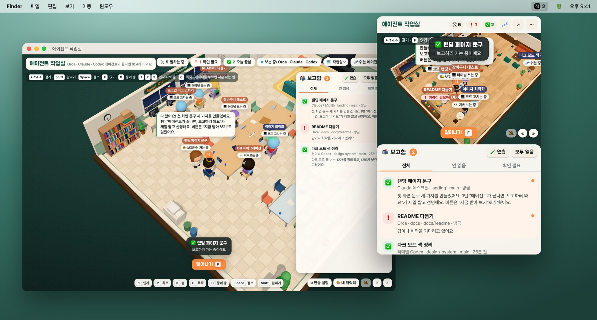
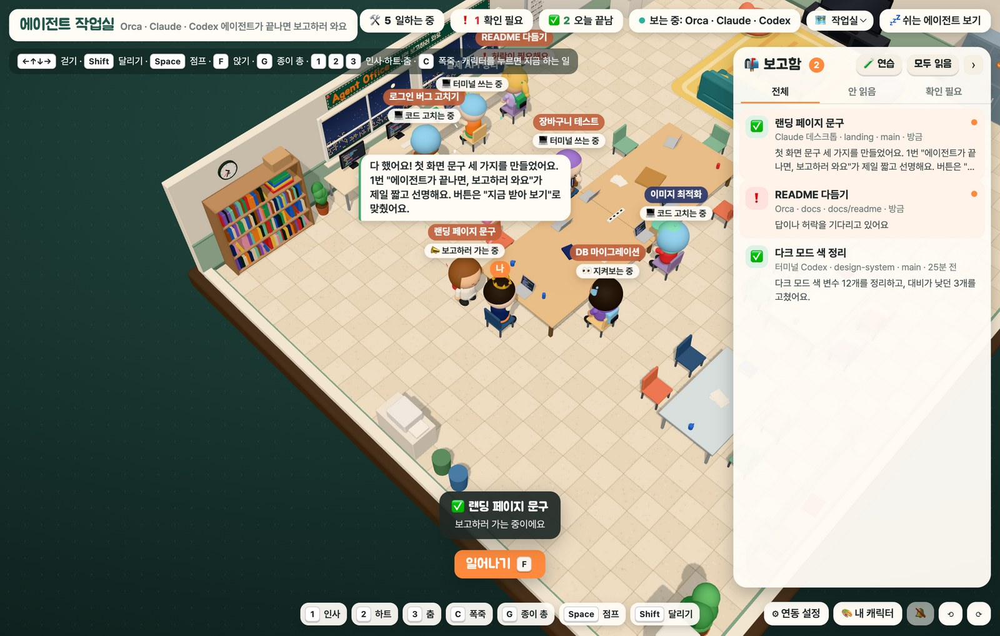
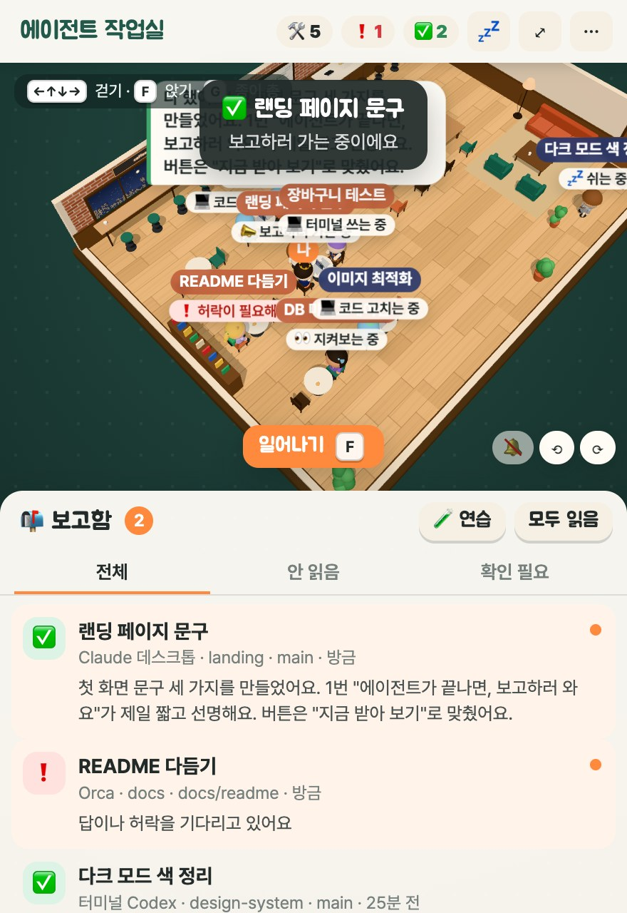
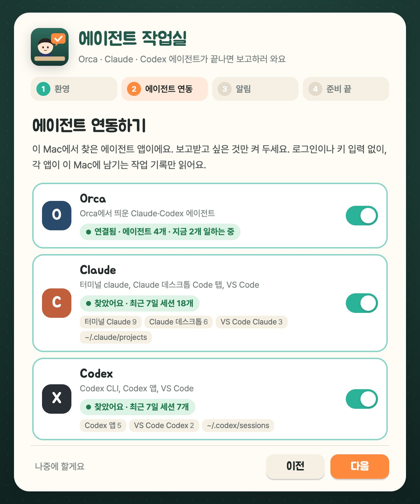

<p align="center">
  
</p>

<h1 align="center">에이전트 작업실</h1>

<p align="center">
  Orca, Claude Code, Codex에 일을 맡겨 두면 3D 작업실에서 캐릭터들이 일하다가<br>
  끝나면 내 자리로 걸어와서 보고해 주는 macOS 상단바 앱이에요.
</p>

<p align="center">
  <a href="https://github.com/sangjun121/agent-office/releases/latest"><b>최신 버전 받기 (DMG)</b></a><br>
  <sub>macOS 13 이상, Apple Silicon</sub>
</p>



## 이런 앱이에요

에이전트 하나가 캐릭터 하나예요. 일하는 중이면 책상에 앉아 노트북을 두드리고, 머리 위에 지금 하는 일("코드 고치는 중", "터미널 쓰는 중")이 떠요.

- **끝나면 보고하러 와요.** 일을 마친 에이전트가 내 자리까지 걸어와서 말풍선으로 결과를 알려 주고, macOS 알림도 보내요.
- **멈춘 에이전트가 바로 보여요.** 허락이나 답을 기다리는 에이전트는 빨간 표시가 붙고 보고함의 "확인 필요"에 모여요.
- **상단바에서 슬쩍 확인해요.** 상단바의 **작** 아이콘을 누르면 작은 창이 펼쳐지고, 다른 곳을 누르면 접혀요. 안 읽은 보고 수는 아이콘 옆에 떠요.
- **돌아다니며 놀 수도 있어요.** 방향키로 걷고, 의자에 앉고, 종이 총을 쏘고, 폭죽을 터뜨릴 수 있어요.

## 화면

### 끝나면 보고하러 와요



보고함에서 항목을 누르면 맡긴 일과 받은 보고를 자세히 볼 수 있어요. 그 에이전트를 돌리던 앱도 버튼 하나로 열려요.


<table>
  <tr>
    <td width="50%" valign="top">
      <b>상단바에서 펼쳐 보기</b><br><br>
      <br><br>
      하던 일을 멈추지 않고 누가 일하는지, 누가 끝났는지만 빠르게 봐요.
    </td>
    <td width="50%" valign="top">
      <b>처음 설정: 에이전트 연동하기</b><br><br>
      <br><br>
      이 Mac에서 찾은 에이전트 앱을 보여 줘요. 보고받고 싶은 것만 켜 두면 되고, 로그인이나 API 키는 필요 없어요.
    </td>
  </tr>
</table>

### 맵은 작업실과 카페 두 가지


### 내 캐릭터 꾸미기


머리, 표정, 모자, 안경, 옷과 색을 고를 수 있어요. **밤티** 버튼을 누르면 포니테일, 더듬이, 콧물처럼 어설프고 정감 가는 조합이 나와요.

## 지원하는 앱

| 앱 | 읽는 곳 |
| --- | --- |
| **Orca** | Orca CLI의 `orca worktree ps --json` 결과 |
| **Claude Code** (터미널 `claude`, Claude 데스크톱의 Code 탭, VS Code 확장) | `~/.claude/projects` 안의 세션 기록 |
| **Codex** (Codex CLI, Codex 앱, VS Code 확장) | `~/.codex/sessions` 안의 세션 기록 |

- 최근 12시간 안에 움직인 세션만 작업실에 나와요.
- Orca에서 띄운 Claude Code, Codex 세션은 Orca 쪽에 한 번만 나와요.
- Claude 데스크톱이나 ChatGPT 데스크톱의 일반 채팅은 이 Mac에 읽을 수 있는 작업 기록이 남지 않아서 지원하지 않아요.

## 설치

1. [Releases](https://github.com/sangjun121/agent-office/releases/latest)에서 `agent-office-0.1.0-arm64.dmg`를 받아요.
2. DMG를 열고 **Agent Office**를 **Applications** 폴더로 끌어다 놓아요.
3. 처음 열면 "Apple에서 확인할 수 없는 개발자" 경고가 떠요. 아직 Apple 개발자 인증(공증)을 받지 않은 앱이라서 그래요.
   - **시스템 설정 → 개인정보 보호 및 보안**으로 가서 아래쪽의 **그래도 열기**를 누르면 돼요.
   - 터미널이 편하면 이렇게 해도 돼요.
     ```sh
     xattr -dr com.apple.quarantine "/Applications/Agent Office.app"
     ```
4. 상단바에 **작** 아이콘이 생기고 처음 설정 창이 열려요. 에이전트를 연동하면 끝이에요.

받은 파일이 릴리스에 올린 파일과 같은지 확인하고 싶다면, 아래 값을 릴리스의 `SHA256SUMS.txt`와 비교해 보세요.

```sh
shasum -a 256 agent-office-0.1.0-arm64.dmg
```

> Intel Mac용 파일은 아직 없어요. 필요하면 [직접 빌드하기](#직접-빌드하기)를 참고하세요.

## 조작법

| 키 | 하는 일 |
| --- | --- |
| 방향키, WASD | 걷기 |
| Shift | 달리기 |
| Space | 점프 (공중에서 한 번 더) |
| F, Enter | 앉기, 일어나기, 가까운 캐릭터 보기 |
| 1 / 2 / 3 | 인사 / 하트 / 춤 |
| C | 폭죽 |
| G | 종이 총 꺼내기 (클릭이나 F로 발사) |
| 캐릭터 클릭 | 그 에이전트가 지금 하는 일 보기 |

상단바 아이콘을 오른쪽 클릭하면 크게 보기, 맵 바꾸기, 쉬는 에이전트 숨기기, 로그인할 때 자동으로 열기를 고를 수 있어요.

## 개인정보와 보안

- **인터넷을 쓰지 않아요.** 앱에서 나가는 요청은 내 Mac(`127.0.0.1`)으로 가는 것 말고는 전부 막아 둬요. 글꼴과 3D 라이브러리도 앱 안에 들어 있고, 사용 통계나 오류 보고, 자동 업데이트도 없어요.
- **읽기만 해요.** Orca 상태와 Claude Code, Codex가 남긴 세션 기록을 읽기만 해요. 기록을 고치거나 지우지 않고, 에이전트에게 명령을 보내지도 않아요.
- **보고는 메모리에만 있어요.** 보고함은 앱을 끄면 사라져요. 파일로 남는 건 설정 파일 `~/Library/Application Support/Agent Office/settings.json` 하나예요.
- **로컬 서버는 내 Mac 안에서만 열려요.** 화면을 띄우는 작은 서버가 `127.0.0.1`에만 열리고, 실행할 때마다 새로 만드는 토큰이 있어야 응답해요.
- 코드가 전부 공개되어 있으니 직접 읽어 보고 빌드해서 써도 돼요.

## 지우기

1. 상단바 아이콘을 오른쪽 클릭하고 **종료**를 눌러요.
2. `/Applications/Agent Office.app`을 휴지통으로 옮겨요.
3. 설정까지 지우려면 `~/Library/Application Support/Agent Office` 폴더도 지워요.

## 직접 빌드하기

Node.js 20 이상이 필요해요.

```sh
git clone https://github.com/sangjun121/agent-office.git
cd agent-office
npm install
npm start          # 바로 실행
npm run dist       # dist/에 DMG와 zip 만들기 (Apple Silicon)
```

- Intel Mac용은 `node scripts/prepare.js && npx electron-builder --mac --x64`로 만들어요.
- `npm run shots`는 README 스크린샷을 가짜 에이전트 데이터로 다시 찍어요. 내 작업 기록은 쓰지 않아요.
- `npm run art`는 앱 아이콘, 상단바 아이콘, DMG 배경을 다시 그려요.

```
main.js      상단바 아이콘, 창, 알림, 외부 요청 차단
server.js    127.0.0.1 로컬 서버와 API
orca.js      에이전트 상태 읽기, 보고 만들기
sources.js   Claude Code, Codex 세션 기록 읽기
renderer/    앱 화면 (3D 작업실, 처음 설정)
shared/      3D 작업실, 카페, 캐릭터 (three.js)
scripts/     아이콘, 스크린샷, 빌드 도우미
```

## 함께 쓴 것

- [three.js](https://threejs.org) (MIT), [Electron](https://www.electronjs.org) (MIT)
- 글꼴 [주아](https://fonts.google.com/specimen/Jua) (OFL), [Pretendard](https://github.com/orioncactus/pretendard) (OFL). 라이선스 전문은 `renderer/fonts`에 있어요.

Orca, Claude, Claude Code, Codex, ChatGPT는 각 회사의 상표예요. 이 프로젝트는 그 회사들과 관계없는 개인 프로젝트예요.
