<p align="center">
  
</p>

<h1 align="center">에이전트 작업실</h1>

<p align="center">
  Claude Code, Codex, Orca에 일을 맡겨 두면<br>
  일이 끝나는 순간 캐릭터가 내 자리로 걸어와서 보고해요.
</p>

<p align="center">
  <a href="https://github.com/sangjun121/agent-office/releases/latest"><b>macOS용 받기 (DMG)</b></a><br>
  <sub>macOS 13 이상, Apple Silicon. 무료 오픈소스(MIT)예요. 인터넷은 YouTube를 틀 때와 새 버전을 확인할 때만 써요.</sub>
</p>

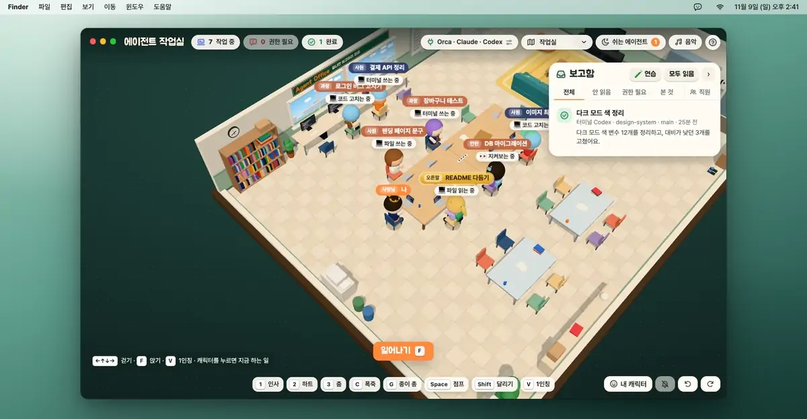

에이전트를 여러 개 돌려 놓고 터미널 탭을 계속 들여다보고 있었다면, 이제 그럴 필요가 없어요. 에이전트 하나가 캐릭터 하나예요. 일하는 동안에는 책상에서 노트북을 두드리고, 다 끝나면 내 자리까지 와서 말풍선으로 결과를 알려 줘요. 권한이 필요하면 자리에서 손을 들고요.

> **AI에 따로 연결하는 앱이 아니에요.** API 키나 로그인 없이, Claude Code, Codex, Orca가 이 Mac에 남긴 세션 기록 폴더를 읽어서 화면에 보여 주기만 해요. 에이전트에게 명령을 보내거나 기록을 바꾸지 않아요.

## 사용 설명서

1. [설치하기](#1-설치하기)
2. [처음 설정](#2-처음-설정)
3. [상단바에서 보기](#3-상단바에서-보기)
4. [보고 받기](#4-보고-받기)
5. [보고함 쓰기](#5-보고함-쓰기)
6. [에이전트 이름 붙이기, 퇴근시키기](#6-에이전트-이름-붙이기-퇴근시키기)
7. [직원과 승진](#7-직원과-승진)
8. [작업실 돌아다니기](#8-작업실-돌아다니기)
9. [맵과 내 캐릭터](#9-맵과-내-캐릭터)
10. [음악: 작업실 라디오와 YouTube](#10-음악-작업실-라디오와-youtube)

[자주 묻는 질문](#자주-묻는-질문) · [개인정보와 보안](#개인정보와-보안) · [지우기](#지우기) · [직접 빌드하기](#직접-빌드하기) · [라이선스](#라이선스)

## 1. 설치하기

1. [Releases](https://github.com/sangjun121/agent-office/releases/latest)에서 `agent-office-0.4.5-arm64.dmg`를 받아요.
2. DMG를 열고 **Agent Office**를 **Applications** 폴더로 끌어다 놓아요.
3. 처음 열면 "Apple에서 확인할 수 없는 개발자" 경고가 떠요. 아직 Apple 공증을 받지 않은 앱이라서 그래요.
   - **시스템 설정 → 개인정보 보호 및 보안**으로 가서 아래쪽의 **그래도 열기**를 누르면 돼요.
   - 터미널이 편하면 이렇게 해도 돼요.
     ```sh
     xattr -dr com.apple.quarantine "/Applications/Agent Office.app"
     ```
4. 상단바에 말풍선 아이콘이 생기고 처음 설정 창이 열려요.

받은 파일이 릴리스에 올린 파일과 같은지 확인하고 싶다면, 아래 값을 릴리스의 `SHA256SUMS.txt`와 비교해 보세요.

```sh
shasum -a 256 agent-office-0.4.5-arm64.dmg
```

> Intel Mac용 파일은 아직 없어요. 필요하면 [직접 빌드하기](#직접-빌드하기)를 참고하세요.

### 새 버전으로 바꾸기

새 버전이 나오면 큰 창 오른쪽 위에 주황색 **업데이트** 버튼이 생겨요. 누르면 바뀐 점이 보이고, **업데이트**를 누르면 새 버전을 받아서 바꾼 뒤 앱이 다시 켜져요. 상단바 아이콘을 오른쪽 클릭하고 **새 버전 확인**을 눌러도 돼요. 설정, 직원 점수, 읽음 표시는 그대로 남아요.

- 앱은 켤 때와 3시간마다 GitHub에 새 버전이 있는지만 물어봐요. 버튼을 누르기 전에는 아무것도 받지 않아요.
- 받은 파일은 개발자 서명과 해시가 맞을 때만 설치해요.
- 0.3.4 이하를 쓰고 있다면 한 번만 새 DMG를 받아서 **Applications** 폴더에 덮어써 주세요. 그다음부터는 버튼으로 바뀌어요.

## 2. 처음 설정

처음 켜면 네 단계짜리 설정이 나와요. 1분이면 끝나요.

<table>
  <tr>
    <td width="50%" valign="top">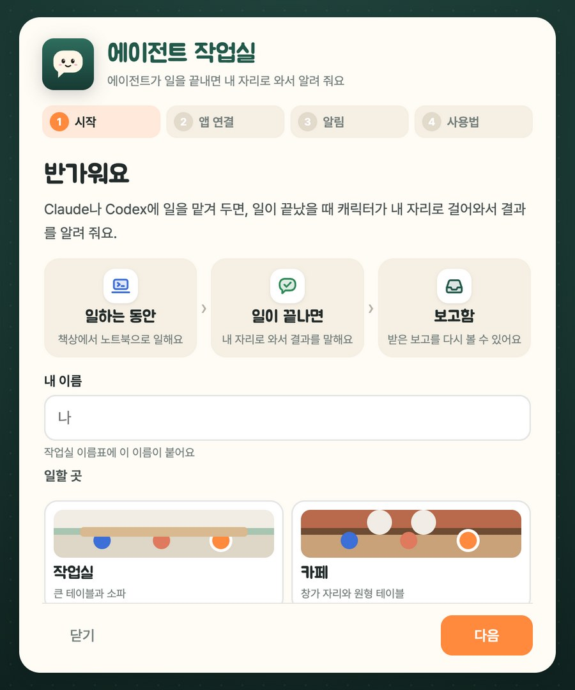</td>
    <td width="50%" valign="top">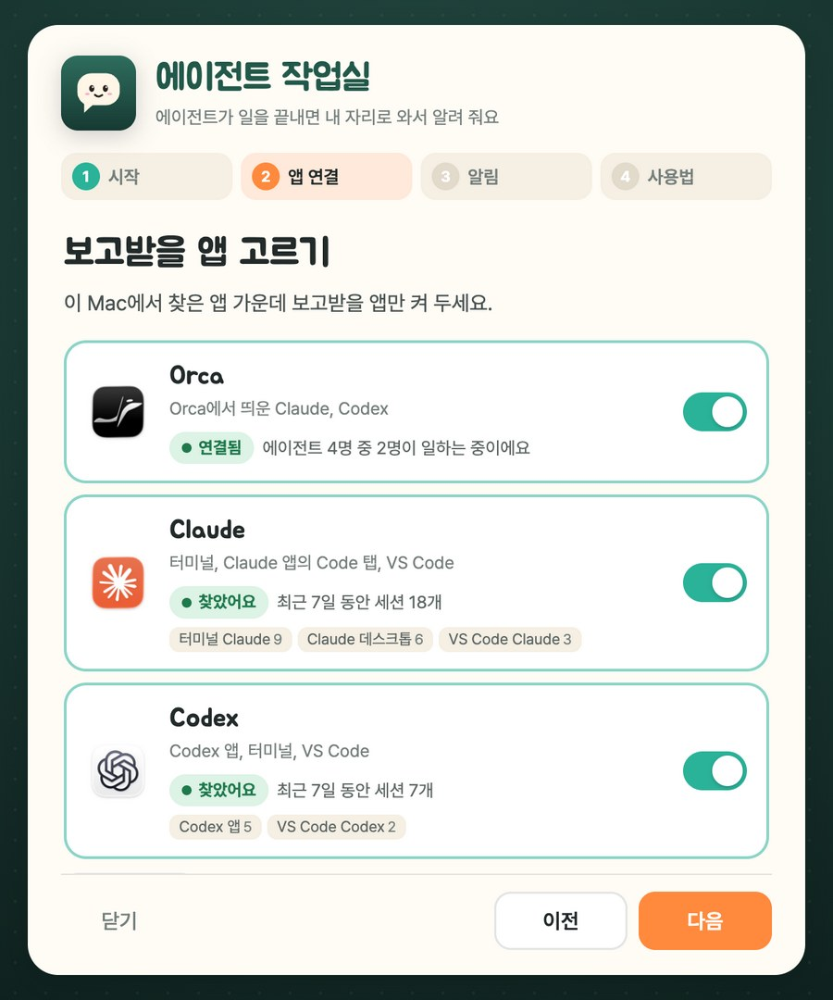</td>
  </tr>
  <tr>
    <td valign="top"><b>시작</b><br>작업실 이름표에 붙을 내 이름과 일할 곳(맵)을 골라요. 맵은 나중에 언제든 바꿀 수 있어요.</td>
    <td valign="top"><b>앱 연결</b><br>이 Mac에 깔린 Orca, Claude, Codex를 찾아서 보여 줘요. 보고받을 앱만 켜 두면 되고, 로그인이나 API 키는 필요 없어요.</td>
  </tr>
</table>

3단계에서는 macOS 알림, 보고 소리, 로그인할 때 열기를 켜고 끌 수 있어요. 4단계는 사용법이에요. 설정과 튜토리얼은 나중에 큰 창 오른쪽 위의 **?** 버튼이나 상단바 아이콘의 오른쪽 클릭 메뉴에서 다시 열 수 있어요.

## 3. 상단바에서 보기

<table>
  <tr>
    <td width="50%" valign="top">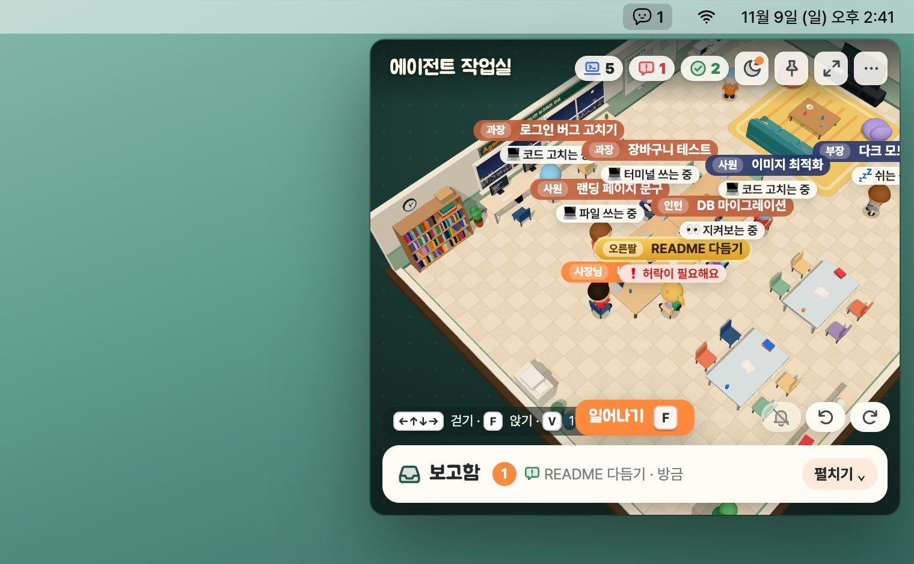</td>
    <td width="50%" valign="top">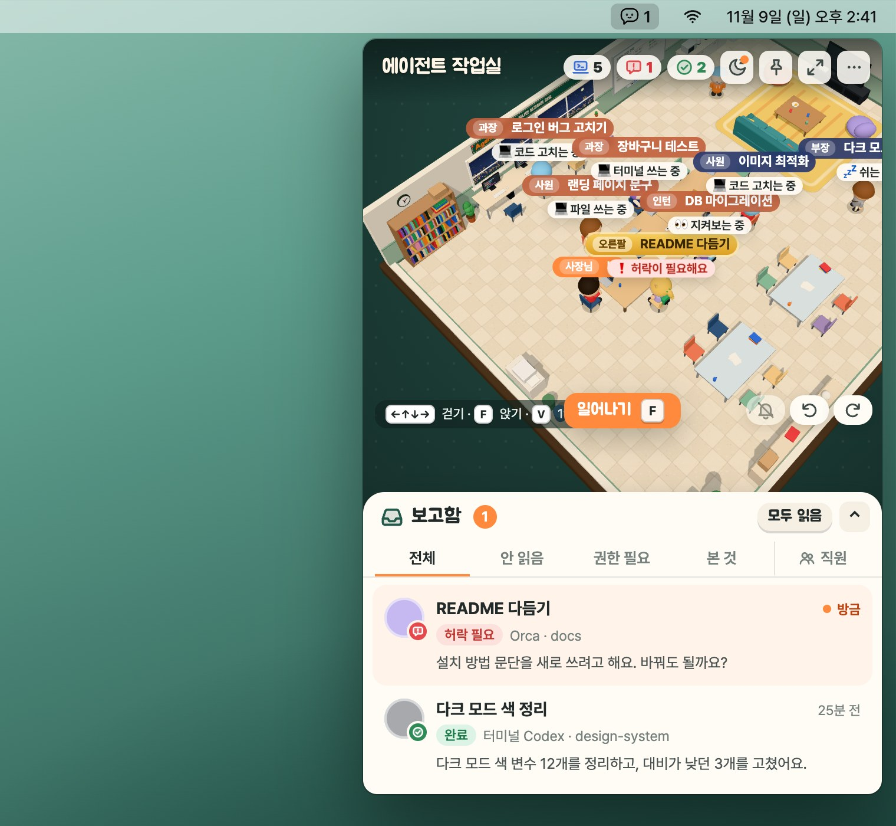</td>
  </tr>
</table>

- 상단바의 **말풍선 아이콘**을 누르면 작은 작업실이 펼쳐지고, 다른 곳을 누르면 접혀요.
- 아이콘 옆 **숫자**는 아직 열어 보지 않은 보고 수예요.
- 열어 볼 보고가 있으면 **보고함**이 펼쳐진 채로 떠요. 방은 위쪽 띠로 줄고, 허락을 기다리는 보고가 맨 위에 나와서 **앱에서 답하기**를 바로 누를 수 있어요.
- 확인할 보고가 없으면 방이 크게 보이고 보고함은 한 줄로 접혀요. **펼치기**와 접기 버튼으로 언제든 바꿀 수 있어요.
- **핀 버튼**을 누르면 고정돼서 다른 곳을 눌러도 안 닫혀요. 고정한 창은 맨 윗줄을 끌어서 옮길 수 있어요.
- **크게 보기 버튼**을 누르면 큰 작업실 창이 열려요.
- 아이콘을 **오른쪽 클릭**하면 맵 바꾸기, 작업실 라디오, YouTube, 쉬는 에이전트 숨기기, 이름표에 직급과 하는 일 보이기, 튜토리얼 다시 보기, 로그인할 때 열기, 새 버전 확인 같은 메뉴가 나와요.

## 4. 보고 받기

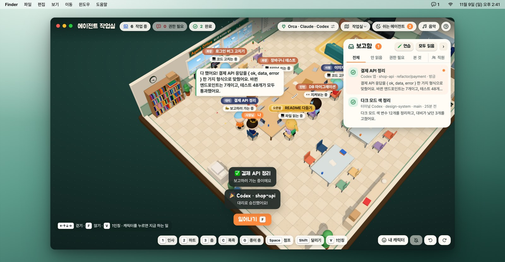

에이전트 머리 위 이름표에는 작업 이름과 상태 점이 붙어요. 파란 점은 일하는 중, 초록 점은 보고하러 오는 중, 흐린 이름표는 쉬는 중이에요. 캐릭터에 마우스를 올리면 지금 하는 일("코드 고치는 중", "터미널 쓰는 중")이 펼쳐져요. 일이 끝나면 내 자리로 걸어와서 말풍선으로 결과를 알려 주고, 보고함에 보고가 하나 쌓여요. 창을 닫아 둬도 macOS 알림으로 알려 줘요.

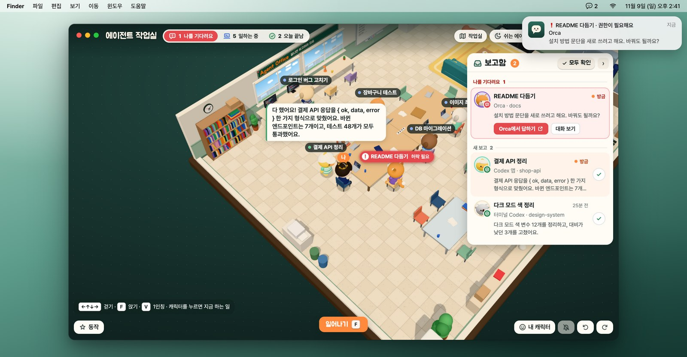

에이전트가 허락이나 답을 기다리면 그 이름표만 빨갛게 커지고 **허락 필요**가 붙어요. 자리에서 손도 들어요. 위쪽 막대의 **나를 기다려요** 칸이 빨갛게 채워지고, 보고함 맨 위와 macOS 알림으로도 알려 줘요.

위쪽 막대의 **나를 기다려요**, **일하는 중**, **오늘 끝남**은 누를 수 있어요. 나를 기다려요를 누르면 그 에이전트로 화면이 옮겨 가고 보고함이 열려요. 일하는 중은 누를 때마다 일하는 에이전트를 차례로 보여 줘요.

## 5. 보고함 쓰기

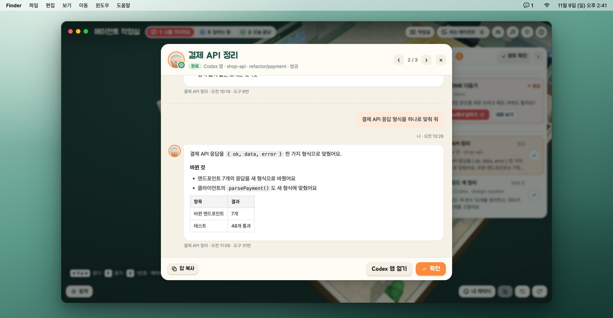

- 보고함은 두 구역이에요. 허락이나 답을 기다리는 보고가 **나를 기다려요**로 맨 위에 모이고, 그 아래에 **새 보고**가 쌓여요.
- 나를 기다리는 보고에는 **앱에서 답하기** 버튼이 줄 안에 있어요. 누르면 그 에이전트를 돌리던 앱이 바로 열려요. 답을 받아 다시 일하기 시작하면 그 보고는 알아서 확인한 보고로 넘어가요.
- 보고를 누르면 그 에이전트와 나눈 대화가 채팅처럼 열려요. 내가 시킨 말은 오른쪽, 에이전트 답은 왼쪽에 나오고, 답은 제목, 굵은 글씨, 목록, 표, 코드 같은 서식 그대로 보여 줘요.
- 마지막 답만이 아니라 이 Mac의 세션 기록에서 최근 대화를 8턴까지 읽어 와요. 위로 올리면 이전 대화가 보이고, 답마다 시각과 도구를 쓴 횟수가 붙어요.
- Orca는 답변 앞부분(200자)만 알려 줘요. 그래서 Orca가 띄운 Claude Code, Codex가 이 Mac에 남긴 기록에서 같은 대화를 찾아 보여 줘요.
- 대화 창 위쪽의 **‹ ›**나 ←, → 키로 이전, 다음 보고로 넘어가요. **답 복사**로 마지막 답을 복사할 수 있어요.
- **앱 열기**를 누르면 그 에이전트를 돌리던 앱이 열려요. Claude 데스크톱과 Codex 앱에서 시작한 일은 **세션 열기**로 그 대화를 바로 열어요. 허락을 기다리는 에이전트는 **앱에서 답하기**가 먼저 나오고, 기다리는 질문이 버튼 줄 바로 위에 고정돼요. Orca는 앱만 열 수 있어요.
- 다 본 보고는 줄 오른쪽의 동그란 **확인** 버튼이나 대화 창의 **확인**으로 보고함에서 빼요. 지운 게 아니라서 맨 아래 **확인한 보고 보기**에서 다시 보고 되돌릴 수 있어요.
- **모두 확인**은 나를 기다리는 보고만 남기고 나머지를 한 번에 확인한 보고로 보내요.
- 동그라미 속 얼굴은 방 안의 그 캐릭터와 같은 얼굴이에요.
- 큰 창에서는 보고함 바깥을 누르면 보고함이 옆으로 접혀요.

## 6. 에이전트 이름 붙이기, 퇴근시키기

<table>
  <tr>
    <td width="50%" valign="top">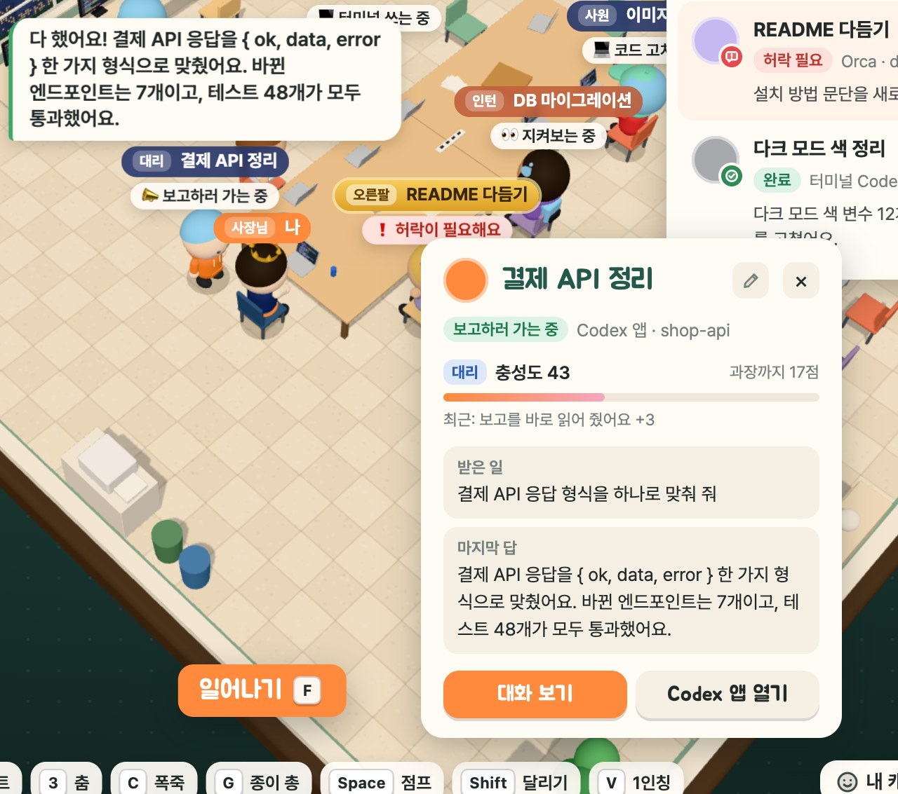</td>
    <td width="50%" valign="top">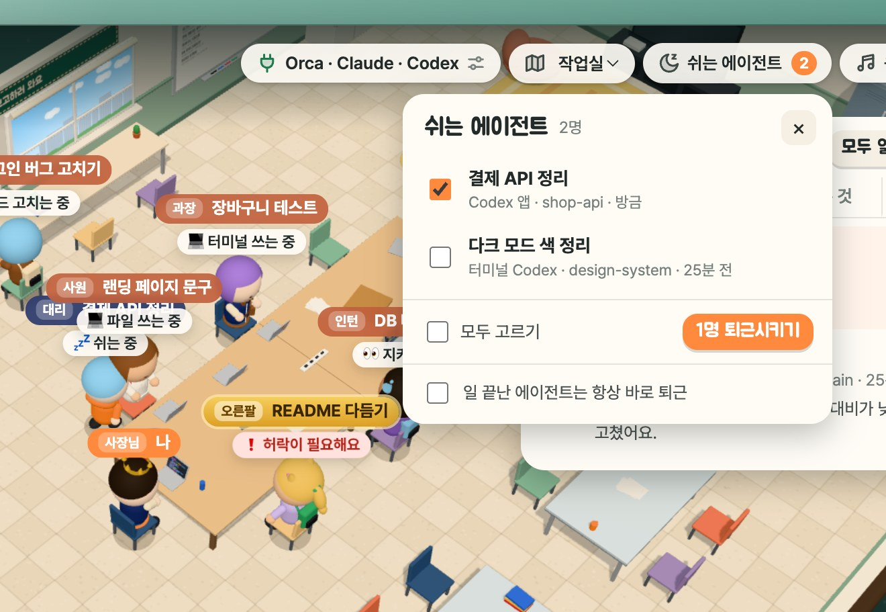</td>
  </tr>
  <tr>
    <td valign="top"><b>이름 붙이기</b><br>캐릭터를 누르면 카드가 떠요. 지금 상태, 받은 일, 마지막 답이 차례로 보이고, **대화 보기**로 그 에이전트와 나눈 대화를 열 수 있어요. 이름 옆 연필을 누르거나 이름을 두 번 누르면 이름을 바꿀 수 있어요. 바꾼 이름은 이름표, 보고함, 알림에 나오고, 비우면 원래 작업 이름으로 돌아가요. 내 캐릭터를 누르면 내 이름도 바꿀 수 있어요.</td>
    <td valign="top"><b>퇴근시키기</b><br>위쪽 막대의 <b>쉬는 에이전트</b> 버튼을 누르면 일을 끝내고 쉬는 에이전트 목록이 나와요. 골라서 퇴근시키면 작업실에서 나가고, 새 일을 받으면 다시 출근해요.</td>
  </tr>
</table>

## 7. 직원과 승진

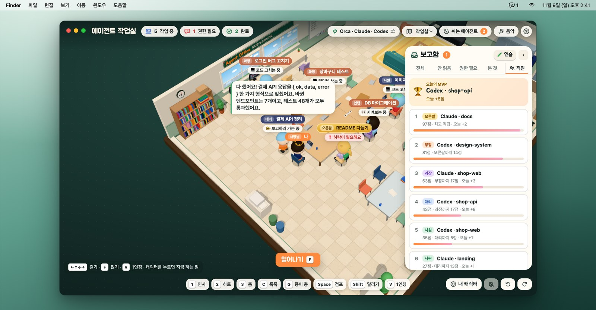

같은 앱과 저장소에서 일하는 에이전트를 한 직원으로 보고 충성도(0~100점)를 매겨요. 세션이 바뀌어도 점수는 이어져요. 직급은 캐릭터 카드 맨 아래와 직원 명부에 나와요. 위쪽 막대의 **직원** 버튼(작은 창은 보고함 머리줄의 직원 버튼)을 누르면 순위와 오늘의 MVP를 볼 수 있어요. 이름표에도 직급을 보고 싶으면 상단바 아이콘의 오른쪽 클릭 메뉴에서 **이름표에 직급과 하는 일 보이기**를 켜세요.

| 점수가 바뀌는 일 | 점수 |
| --- | --- |
| 보고를 10분 안에 읽어 줌 | +3 |
| 권한 요청에 5분 안에 답함 | +5 |
| 일을 잘 끝냄 | +2 |
| 가까이서 하트(2) 보내기 (하루 5번까지) | +1 |
| 그날 처음 출근 | +1 |
| 보고를 하루 넘게 안 읽음 | -2 |
| 일이 중단됨 | -1 |
| 종이 총에 맞음 | -1 |

직급은 인턴(0) → 사원(20) → 대리(40) → 과장(60) → 부장(80) → 오른팔(95) 순이에요. 승진하면 폭죽이 터져요. 대리부터는 뛰어와서 보고하고, 과장은 커피를 들고 와요. 부장은 경례하며 보고해요. 오른팔은 이름표에 금테를 두르고 내 옆자리에 앉아요. 실제 작업에는 아무 영향이 없는 재미 요소예요.

## 8. 작업실 돌아다니기

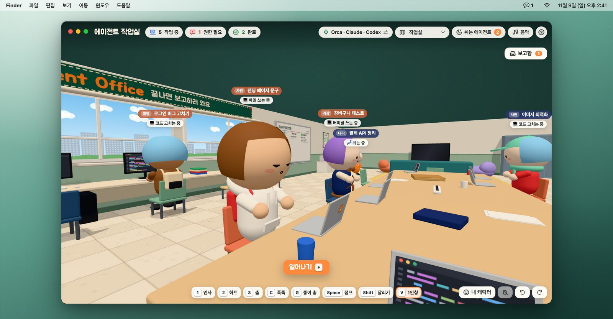

내 캐릭터도 작업실 안을 걸어 다닐 수 있어요. **V**를 누르면 내 눈높이로 보는 1인칭이 돼요. 1인칭에서는 ↑↓로 걷고 ←→로 돌아요. 화면을 끌면 둘러볼 수 있고, V나 Esc를 누르면 위에서 보는 화면으로 돌아와요.

문 앞에 가면 **맵 이동하기**가 떠요. F를 누르고 갈 맵을 고르면 그 맵으로 옮겨 가요.

인사, 춤, 1인칭 같은 동작은 왼쪽 아래 **동작** 버튼을 눌러도 돼요. 조작법도 그 창 아래에 적혀 있어요.

| 키 | 하는 일 |
| --- | --- |
| 방향키, WASD | 걷기 |
| Shift | 달리기 |
| Space | 점프 (공중에서 한 번 더) |
| F, Enter | 앉기, 일어나기, 가까운 캐릭터 보기, 문 앞에서 맵 이동하기, 공 차기 (축구장, Shift를 누른 채 차면 더 세게) |
| V | 1인칭으로 보기 |
| E | 창문 보기 (비행기 창가 자리에 앉아서) |
| K | 프리킥 (축구장): ←→로 방향, F를 누르고 있다 떼면 슛, Shift를 누른 채 떼면 감아 차기 |
| 1 / 2 / 3 | 인사 / 하트 / 춤 |
| C | 폭죽 |
| G | 종이 총 꺼내기 (클릭이나 F로 쏘기) |
| 캐릭터 클릭 | 그 에이전트가 지금 하는 일 보기 |
| 화면 끌기, 휠 | 카메라 돌리기, 가까이 보기 |

## 9. 맵과 내 캐릭터

맵은 여섯 가지예요. 위쪽 막대의 맵 버튼이나 상단바 메뉴에서 바꾸거나, 문 앞에서 F를 눌러 옮겨 갈 수 있어요.

<table>
  <tr>
    <td width="50%" valign="top">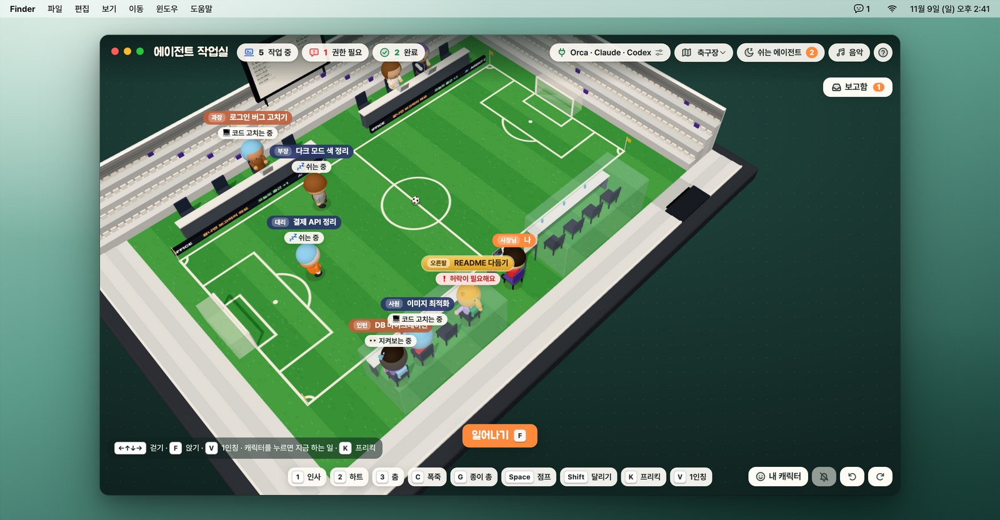<br><b>축구장</b><br>하얀 관중석이 둘러싼 그라운드예요. 에이전트는 기자석과 벤치에서 일하고, 쉬는 동안에는 그라운드에 나와 있어요. 나는 감독석에 앉고, 오늘의 작업 현황은 전광판에 떠요. 가운데 공은 F로 차거나 걸어가서 밀 수 있고, 골대에 넣으면 폭죽이 터져요. K를 누르면 수비벽과 골키퍼를 세워 두고 프리킥을 찰 수 있어요.</td>
    <td width="50%" valign="top">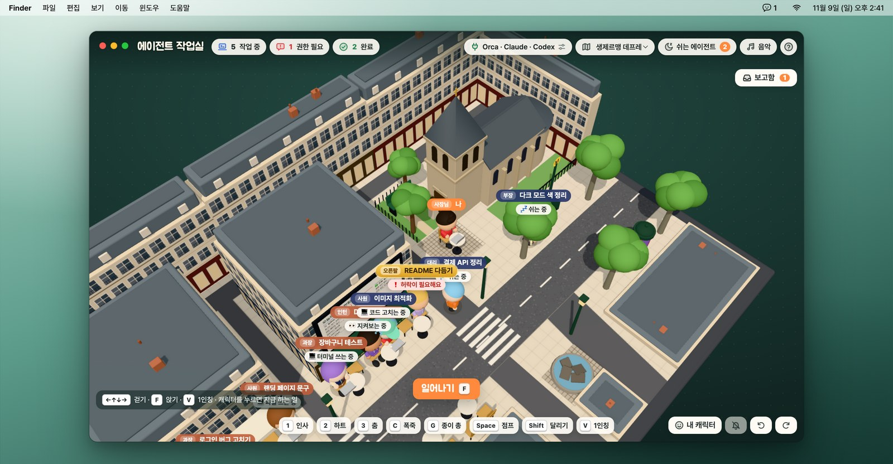<br><b>파리</b><br>파리 생제르맹 데프레의 실제 거리 배치를 작게 옮겼어요. 생제르맹 대로, 종탑이 있는 성당과 그 앞 광장, 보나파르트 거리, 렌 거리가 시작되는 퀘벡 광장, 메트로 4호선 입구가 있어요. 에이전트는 카페 테라스에서 일하고 지하철로 출근해요.</td>
  </tr>
  <tr>
    <td valign="top">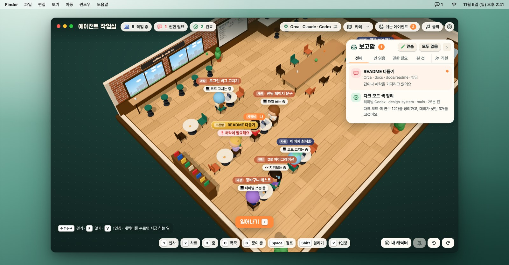<br><b>카페</b><br>창가 바, 큰 테이블, 소파 라운지가 있는 카페예요.</td>
    <td valign="top">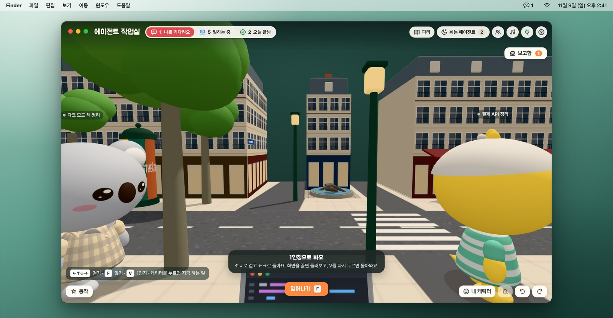<br><b>1인칭으로 보면</b><br>어느 맵에서든 V를 누르면 그 자리에 서 있는 것처럼 둘러볼 수 있어요.</td>
  </tr>
</table>

<table>
  <tr>
    <td width="50%" valign="top">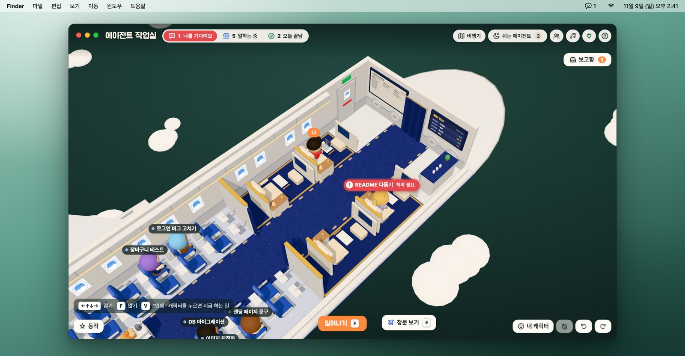<br><b>비행기</b><br>하얀 벽에 타원 창문이 줄지어 있는 기내예요. 나는 일등석 창가에 앉고, 에이전트는 일반석 접이식 테이블에서 일해요. 쉬는 에이전트도 일반석 자기 자리에 앉아서 쉬어요. 오늘의 작업 현황은 앞 칸막이의 화면에 뜨고, 밖에는 구름이 뒤로 흘러가요.</td>
    <td width="50%" valign="top">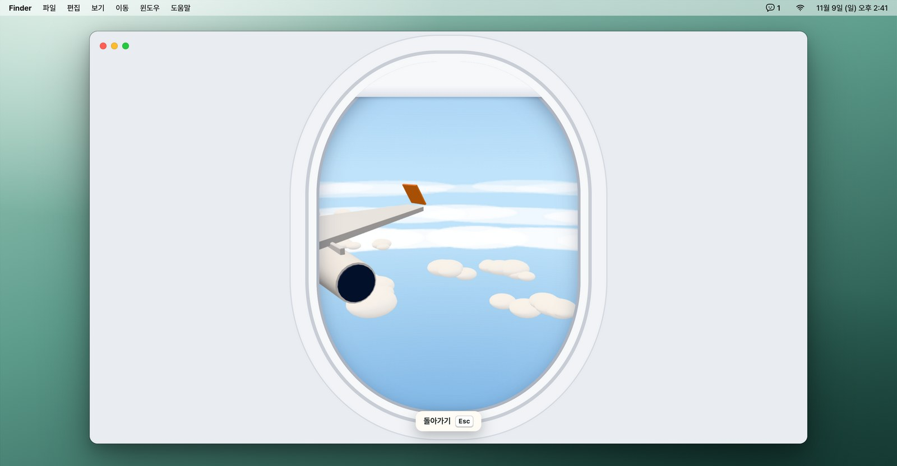<br><b>창문 보기</b><br>창가 자리에 앉아 <b>창문 보기</b>를 누르거나 E를 누르면 그 창으로 밖을 내다봐요. 날개와 엔진, 흘러가는 구름이 보이고, 하늘색은 지금 시각에 따라 바뀌어요. Esc를 누르거나 움직이면 돌아와요.</td>
  </tr>
</table>

<table>
  <tr>
    <td width="50%" valign="top">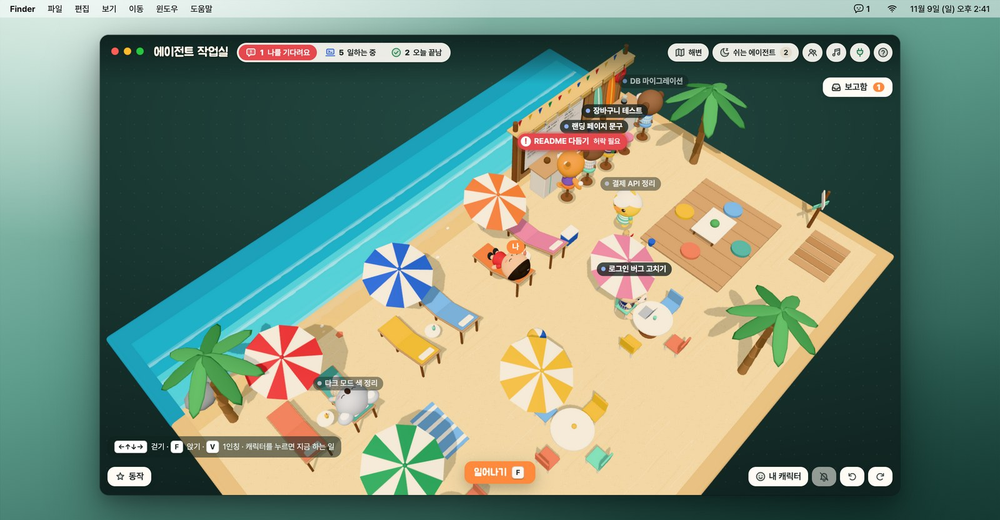<br><b>해변</b><br>파도가 밀려오는 바다 앞 모래밭이에요. 나는 파라솔 옆 선베드에 누워서 시작하고, 에이전트는 파라솔 테이블과 해변 바에서 일해요. 쉬는 에이전트는 선베드에 눕거나 나무 데크 방석에 앉아요. 오늘의 작업 현황은 해변 바 뒤판에 걸려 있어요. 빈 선베드에 가까이 가서 F를 누르면 누울 수 있어요.</td>
    <td width="50%" valign="top"></td>
  </tr>
</table>

기본 맵인 **작업실**은 큰 테이블과 소파가 있는 사무실이에요. 맨 위 움직이는 그림에 나오는 곳이에요.

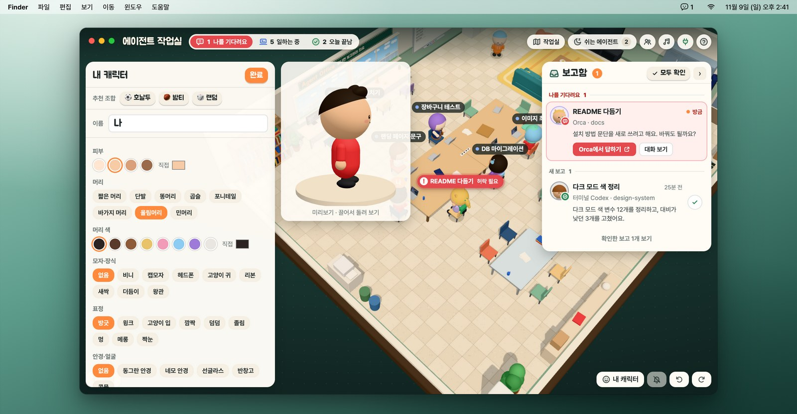

에이전트는 동물 주민으로 나와요. 고양이, 강아지, 곰, 토끼, 여우, 햄스터, 코알라, 돼지, 펭귄, 오리가 있고, 같은 에이전트는 늘 같은 동물이에요. 나는 사람으로 시작해요.

오른쪽 아래 **내 캐릭터** 버튼으로 종류(사람이나 동물), 눈, 머리, 표정, 모자, 안경, 옷과 색을 고를 수 있어요. 동물을 고르면 피부 색 칸이 털 색이 돼요. 추천 조합으로 **호날두**(빨간 7번 유니폼, 올림머리), **밤티**(포니테일, 더듬이, 콧물), **랜덤**이 있어요.

## 10. 음악: 작업실 라디오와 YouTube

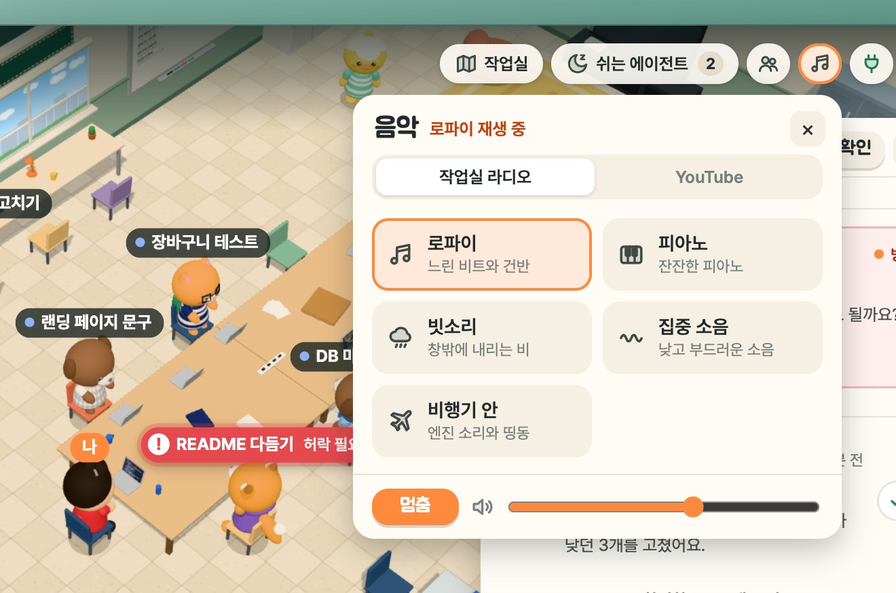

큰 창 위쪽 막대의 **음악** 버튼을 누르면 바로 아래로 작은 창이 펼쳐져요. **작업실 라디오**와 **YouTube** 두 칸이 있어요.

### 작업실 라디오

일하면서 틀어 둘 음악이 앱 안에 들어 있어요. 음악 파일이나 인터넷 없이, 앱이 그 자리에서 만들어 내는 음악이라 매번 조금씩 다르게 흘러가요.

| 채널 | 이런 소리 |
| --- | --- |
| 로파이 | 느린 비트와 따뜻한 건반, 레코드판 잡음 |
| 피아노 | 잔잔하게 펼쳐 치는 피아노 |
| 빗소리 | 창밖에 내리는 비 |
| 집중 소음 | 낮고 부드러운 소음 |
| 비행기 안 | 낮게 깔리는 엔진 소리와 바람 소리, 가끔 울리는 띵동 |

1. 채널을 누르면 바로 나와요. **재생**, **멈춤** 버튼과 볼륨 막대로 조절해요.
2. 창을 닫아도 계속 나와요. 상단바 아이콘을 오른쪽 클릭하고 **작업실 라디오**에서 채널을 고르거나 끌 수도 있어요.
3. **소음 가리기 함께 켜기**를 켜 두면 고른 채널 밑에 고른 소음이 함께 깔려서 주변 말소리와 키보드 소리를 덮어 줘요. 채널을 바꿔도 켜진 채로 있어요. 헤드폰의 노이즈 캔슬링처럼 소리를 지우는 것은 아니고 덮는 방식이라 마이크는 쓰지 않아요.

### YouTube

YouTube 링크를 붙여넣고 **재생**을 누르면 작은 칸에서 영상이 나와요. 영상, 재생목록, 믹스, YouTube Music 링크 모두 돼요.

1. 창을 닫아도 소리는 계속 나요. 끌 때는 **끄기**나 상단바 메뉴의 **YouTube → 끄기**를 눌러요.
2. 라디오와 YouTube 중 하나만 나와요. 하나를 틀면 다른 하나는 꺼져요.
3. 로그인하지 않은 상태로 틀어서 영상 앞에 광고가 나올 수 있어요.

이 칸만 YouTube와 Google 서버에 접속하고, 링크를 넣고 재생할 때만 접속해요. 작업실 화면과 따로 떨어진 공간에서 돌고, 앱을 끄면 YouTube 쿠키도 지워져요.

## 자주 묻는 질문

<details>
<summary><b>설치할 때 경고가 떠요. 안전한가요?</b></summary>

경고는 Apple 공증을 받지 않은 앱이라서 떠요. macOS가 개발자를 확인하지 못했다는 뜻이고, 악성 코드가 발견됐다는 뜻은 아니에요. 대신 직접 확인할 수 있는 것들을 공개해 뒀어요.

- 코드가 전부 이 저장소에 있어요. 앱에는 이 코드와 three.js, 글꼴만 들어 있어요.
- 받은 파일이 릴리스 파일과 같은지 `SHA256SUMS.txt`로 확인할 수 있어요.
- 사용 통계와 오류 보고가 없어요. 인터넷은 YouTube를 틀 때와 새 버전을 확인할 때만 써요.
- 실행하는 외부 명령은 `open`(앱과 폴더 열기), `orca`(상태 읽기), `mdfind`(앱 아이콘 찾기), 그리고 업데이트할 때 쓰는 `ditto`, `codesign`, `PlistBuddy`(받은 앱을 풀고 확인하기)예요.
- 그래도 걱정되면 [직접 빌드하기](#직접-빌드하기)대로 소스에서 빌드해 쓸 수 있어요.
</details>

<details>
<summary><b>상단바에 아이콘이 안 보여요</b></summary>

상단바에 아이콘이 많으면 새로 생긴 아이콘이 노치(카메라 자리)나 메뉴 뒤로 가려질 수 있어요.

1. **바로 열기**: <kbd>⌘</kbd> <kbd>Space</kbd>로 Spotlight를 열고 **Agent Office**를 실행하면 작업실 창이 떠요. 보고 알림을 눌러도 열려요.
2. **자리 만들기**: **시스템 설정 → 메뉴 막대**에서 안 쓰는 항목을 끄면 자리가 생겨요. macOS 15 이하라면 **시스템 설정 → 제어 센터**에서 끌 수 있어요.
3. **자리 옮기기**: 아이콘이 다시 보이면 <kbd>⌘</kbd> 키를 누른 채 시계 쪽으로 끌어다 놓으세요. 다음에 켜도 그 자리에 떠요.
</details>

<details>
<summary><b>어떤 앱을 지원하나요?</b></summary>

| 앱 | 읽는 곳 |
| --- | --- |
| **Orca** | Orca CLI의 `orca worktree ps --json` 결과 |
| **Claude Code** (터미널 `claude`, Claude 데스크톱의 Code 탭, VS Code 확장) | `~/.claude/projects` 안의 세션 기록 |
| **Codex** (Codex CLI, Codex 앱, VS Code 확장) | `~/.codex/sessions` 안의 세션 기록 |

- 최근 12시간 안에 움직인 세션만 작업실에 나와요. 며칠 전에 시작한 대화를 이어서 써도 나와요.
- Orca에서 띄운 Claude Code, Codex 세션은 Orca 쪽에 한 번만 나와요.
</details>

<details>
<summary><b>Claude 앱이나 ChatGPT 앱의 일반 채팅도 보이나요?</b></summary>

아니요. 일반 채팅은 이 Mac에 읽을 수 있는 작업 기록이 남지 않아서 볼 수 없어요. Claude 앱의 **Code 탭**에서 맡긴 일은 Claude로 나와요.
</details>

<details>
<summary><b>Orca 세션도 바로 열 수 있나요?</b></summary>

아직은 Orca 앱만 열려요. Orca가 특정 세션을 여는 주소를 제공하지 않아서 그래요. Claude 데스크톱과 Codex 앱은 **세션 열기**로 그 대화를 바로 열 수 있어요.
</details>

<details>
<summary><b>아이패드에 띄워 두고 싶어요</b></summary>

macOS의 **사이드카**를 쓰면 돼요. 제어 센터 → 화면 미러링에서 아이패드를 고르고 '확장 디스플레이'로 둔 다음, 작업실 큰 창을 아이패드 화면으로 옮겨 전체 화면으로 바꾸세요. Mac 화면이 꺼지면 사이드카도 꺼지니, 계속 띄워 두려면 시스템 설정 → 잠금 화면에서 디스플레이가 꺼지지 않게 해 두세요.
</details>

<details>
<summary><b>알림이 안 와요</b></summary>

**시스템 설정 → 알림 → Agent Office**에서 알림이 켜져 있는지 확인하세요. 처음 설정 3단계나 상단바 메뉴에서 앱 안의 알림 설정도 켜 둬야 해요.
</details>

## 개인정보와 보안

- **인터넷은 두 경우에만 써요.** 앱에서 나가는 요청은 내 Mac(`127.0.0.1`)으로 가는 것 말고는 전부 막아 둬요. 예외는 둘이에요.
  - **YouTube 칸:** 링크를 넣고 재생할 때만 YouTube와 Google 서버에 접속해요. 작업실 화면과 따로 떨어진 공간에서 돌고, 앱을 끄면 쿠키도 지워져요.
  - **새 버전 확인:** 켤 때와 3시간마다 GitHub에 새 버전 정보(`latest.json`)만 물어봐요. 업데이트 버튼을 누를 때만 앱 파일을 받고, 개발자 서명과 해시가 맞아야 설치해요.

  글꼴, 3D 라이브러리, 라디오 음악은 모두 앱 안에서 해결하고, 사용 통계나 오류 보고는 없어요.
- **읽기만 해요.** Orca 상태와 Claude Code, Codex가 남긴 세션 기록을 읽기만 해요. 기록을 고치거나 지우지 않고, 에이전트에게 명령을 보내지도 않아요. 대화 창을 열 때 그 에이전트의 기록에서 최근 대화를 읽어 와 화면에 보여 주기만 하고, 따로 저장하거나 밖으로 보내지 않아요.
- **보고 내용은 메모리에만 있어요.** 앱을 끄면 보고함이 비워지고, 다시 켤 때 최근 기록으로 채워요. 파일로 남는 건 설정 파일 `~/Library/Application Support/에이전트 작업실/settings.json` 하나예요. 직원 점수, 읽음 표시, 라디오 채널과 볼륨도 이 파일에 들어 있어요. 읽음 표시는 보고 내용 없이 짧은 지문(해시)만 남겨요.
- **다른 앱 아이콘은 그때그때 읽어요.** 앱 연결 화면의 Orca, Claude, Codex 아이콘은 이 Mac에 깔린 앱에서 읽어 와요.
- **로컬 서버는 내 Mac 안에서만 열려요.** 화면을 띄우는 작은 서버가 `127.0.0.1`에만 열리고, 실행할 때마다 새로 만드는 토큰이 있어야 응답해요. 사용자가 등록할 키는 없어요.
- **앱 파일이 바뀌면 실행되지 않아요.** 앱 묶음 안의 코드 파일(`app.asar`)이 빌드 때와 다르면 켜지지 않고, 이 앱을 Node 실행기나 디버거로 쓰는 것도 막아 뒀어요(Electron 보안 스위치).
- **YouTube 칸은 바깥 주소를 열지 않아요.** 광고 같은 스크립트가 다른 사이트로 옮기거나 새 창을 띄우려 해도 막아요.
- 코드가 전부 공개되어 있으니 직접 읽어 보고 빌드해서 써도 돼요.

## 지우기

1. 상단바 아이콘을 오른쪽 클릭하고 **종료**를 눌러요.
2. `/Applications/Agent Office.app`을 휴지통으로 옮겨요.
3. 설정까지 지우려면 `~/Library/Application Support/에이전트 작업실` 폴더도 지워요.

## 직접 빌드하기

Node.js 20 이상이 필요해요.

```sh
git clone https://github.com/sangjun121/agent-office.git
cd agent-office
npm install
npm start          # 바로 실행
npm run dist       # dist/에 DMG와 zip 만들기 (Apple Silicon)
```

- Intel Mac용은 `node scripts/prepare.js && npx electron-builder --mac --x64`로 만들어요.
- `npm run shots`는 README 그림을 가짜 에이전트 데이터로 다시 찍어요. 내 작업 기록은 쓰지 않아요.
- `npm run hero`, `npm run promo`는 맨 위 움직이는 그림과 홍보 영상의 프레임을 찍어요. 끝나면 [ffmpeg](https://ffmpeg.org)로 굽는 명령을 알려 줘요.
- `npm run art`는 앱 아이콘, 상단바 아이콘, DMG 배경을 다시 그려요.
- `npm run dist`는 업데이트 서명 열쇠(`~/.agent-office-release/update-key.pem`)가 있으면 `dist/latest.json`도 서명해서 만들어요. 열쇠가 없으면 건너뛰어요.

```
main.js      상단바 아이콘, 창, 알림, 외부 요청 차단, 작업실 라디오, YouTube 칸
updater.js   새 버전 확인과 업데이트 (서명과 해시 확인)
server.js    127.0.0.1 로컬 서버와 API
orca.js      에이전트 상태 읽기, 보고 만들기
sources.js   Claude Code, Codex 세션 기록 읽기
staff.js     충성도와 직급
appicons.js  이 Mac에 깔린 Orca, Claude, Codex 아이콘 읽기
renderer/    앱 화면 (3D 작업실, 처음 설정, 라디오 음악)
shared/      맵(작업실, 카페, 축구장, 파리, 비행기, 해변)과 캐릭터 (three.js)
scripts/     아이콘, README 그림, 홍보 영상, 빌드 도우미, 업데이트 서명
```

## 라이선스

[MIT 라이선스](LICENSE)로 공개해요. 누구나 쓰고, 고치고, 다시 배포할 수 있어요. 다시 배포할 때는 저작권 표시와 라이선스 전문을 함께 넣어 주세요. 앱에 들어 있는 글꼴은 각자의 라이선스(OFL)를 따라요.

## 함께 쓴 것

- [three.js](https://threejs.org) (MIT), [Electron](https://www.electronjs.org) (MIT)
- 글꼴 [주아](https://fonts.google.com/specimen/Jua) (OFL), [Pretendard](https://github.com/orioncactus/pretendard) (OFL). 라이선스 전문은 `renderer/fonts`에 있어요.

Orca, Claude, Claude Code, Codex, ChatGPT는 각 회사의 상표예요. 이 프로젝트는 그 회사들과 관계없는 개인 프로젝트예요. 축구장 맵은 특정 구단과 관계없는 창작물이고, 파리 맵의 가게 이름은 지어낸 이름이에요.
